# OWASP_CTF_16102026_WriteUp

This report contains the solution and walkthrough for the challenge completed during the OWASP CTF.

---

## 🛠️ REVERSE ENGINEERING

### 🧩 Challenge: Code Maze

* **Goal:** Deobfuscate the provided Python file and determine its core functionality to retrieve the flag.
* **Given:** An obfuscated Python script.

#### How I Solved It:

1. **Dynamic Analysis:** 
   Ran the Python file inside an isolated virtual environment (`venv`). The script prompted for a password input. Entering `test` resulted in a `Wrong!` output.

2. **Static Analysis:** 
   Opened the source code of the file and discovered that it uses `base64` decoding and `zlib` decompression to dynamically execute hidden payload data:
   ```python
   data = b"eJxVzLEKwjAQgOE9T3He1CzSkroUOojoquDQsdQ2rcE2CXdXtIjvLggKjv83/MpNMZAAL6xiw3wP1EEJzsdZEtx7sQRfLwC1cv2voSwB2bRkBAsFABDJeUlwF4hsKys4jM1QwLHank/P9NLPmzaXLPX1lN8M15nU15w6Qy/Uyo5s/yYVBT+sUH+MF17bh5Mk0+oNmck4FQ=="
   exec(zlib.decompress(base64.b64decode(data)))
   ```

3. **Deobfuscation:** 
   Modified the script to intercept the payload. By changing the `exec()` function to a `print()` statement, the script printed the decoded and decompressed source code directly to the console instead of running it. This revealed the flag.

* **Flag:** `OWASP{0bfu5c4t10n_m4k3s_1t_h4rd3r}`

#### 📸 Challenge Screenshots
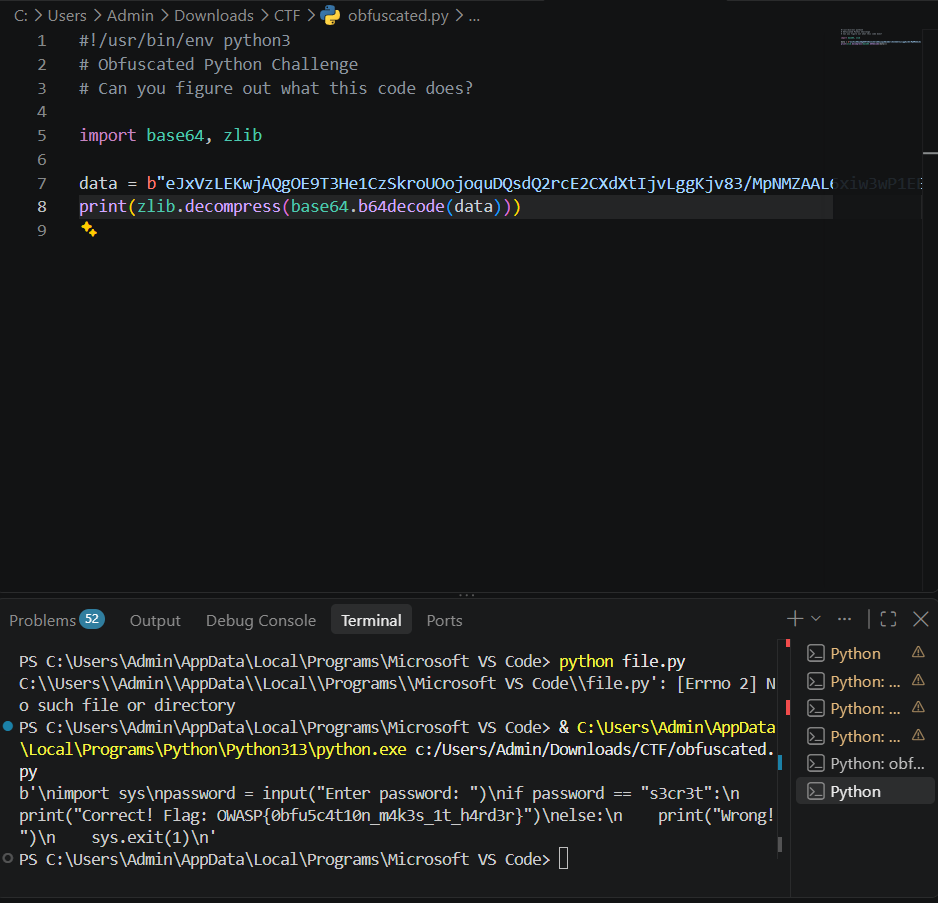
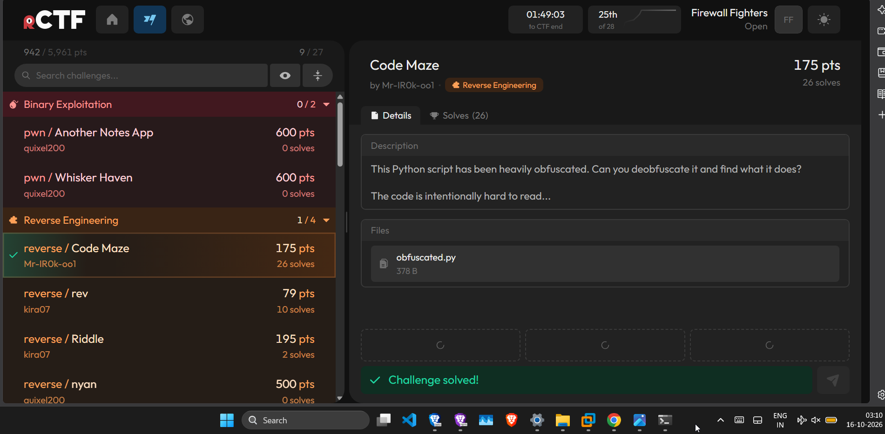

---

## CRYPTOGRAPHY

### Challenge: Caesar's Secret

* **Goal:** Decode the flag hidden inside the provided text file.
* **Given:** A `.txt` file containing an encrypted flag string.

#### How I Solved It:
1. **Identification:** Identified the cipher as a classic Caesar Cipher based on the challenge context.
2. **Decryption:** Used the online modular conversion tool **Cryptii** (`https://cryptii.com`) to analyze the text.
3. **Brute Force / Shifting:** Shifted each letter through the alphabet and successfully found the readable flag at a character shift layout of **13**.

* **Flag:** `OWASP{c43s4r_c1ph3r_1s_34sy_t0_cr4ck}`

#### Challenge Screenshots
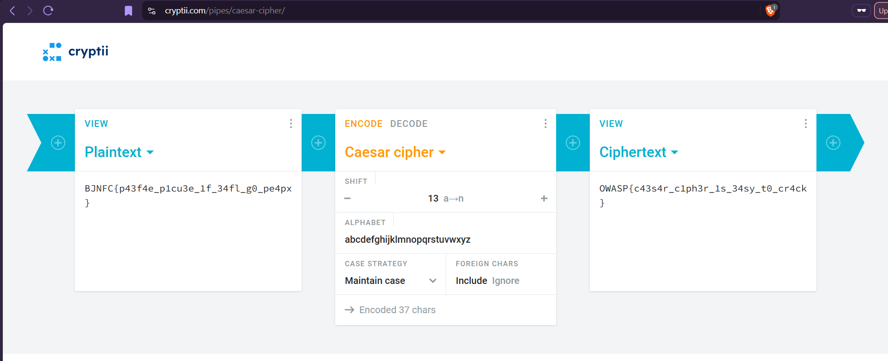
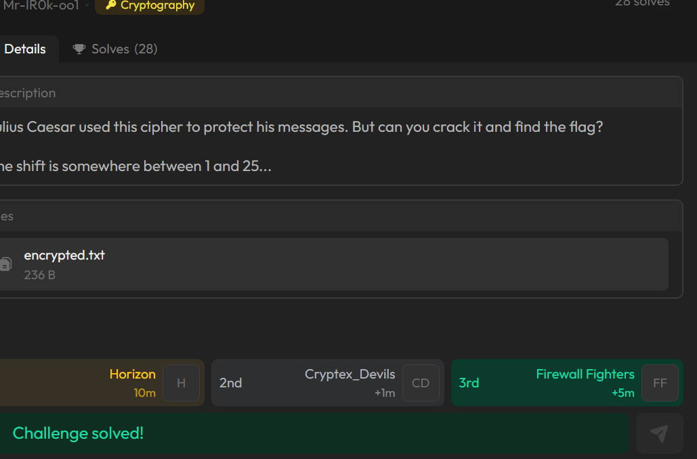

---

### Challenge: Encoding Chaos

* **Goal:** Decode a multi-layered encoded flag string.
* **Given:** A file containing an unusual, non-standard text string with a hint pointing to multi-layer encoding.

#### How I Solved It:
1. **Encoding Detection:** Used **CyberChef** (`https://gchq.github.io/CyberChef/#recipe=`) and applied the **Magic** recipe since the initial encoding type was unknown. The tool identified the format pattern as **Base64**.
2. **Iterative Decoding:** Applied the **From Base64** recipe filter. The first decoding pass resulted in another string. Repeated the exact decoding process loop layer by layer until the nested encoding was fully stripped away to reveal the plaintext flag.

* **Flag:** `OWASP{b4s364_1s_n0t_3ncrypt10n}`

#### Challenge Screenshots
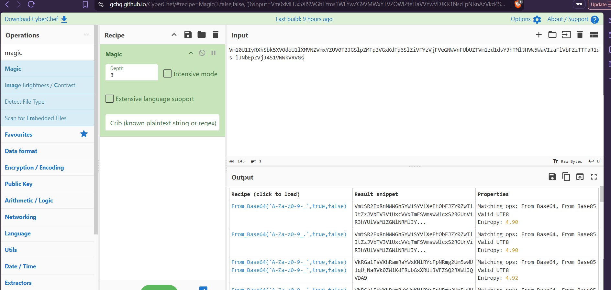
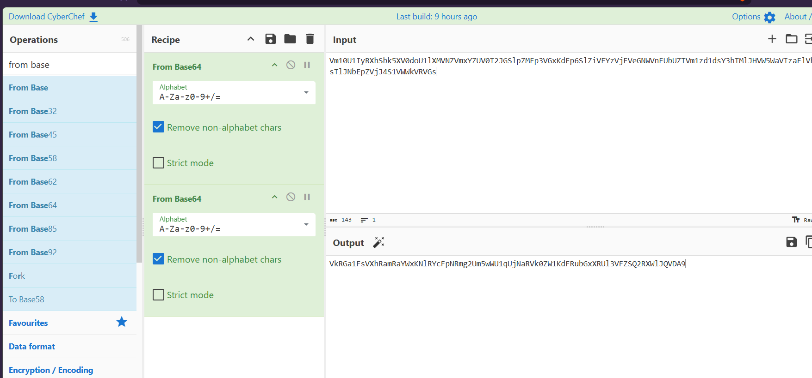
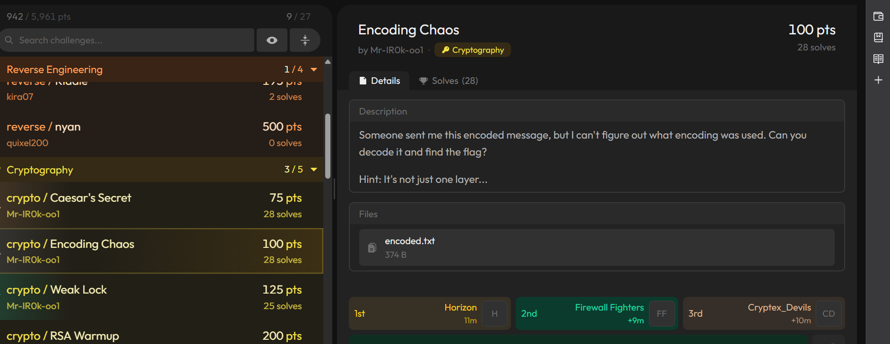

---

### Challenge: Weak Lock

* **Goal:** Decrypt a custom XOR cipher that uses a predictable 4-bit (or 4-character) repeating key.
* **Given:** A file containing a hex-encoded encrypted string.

#### How I Solved It:
1. **Research & Script Customization:** Lacking prior experience with XOR decryption, I researched the methodology on Medium and located a Python script designed to brute-force a repeating XOR key using known plaintext attacks. I modified the script's expected plaintext boundaries to match the target CTF format (`OWASP{` and `}`).
2. **Key Recovery:** Running the script against the provided hex string successfully extracted the repeating key pattern. Since the challenge specified a 4-character limitation, the structural key sequence was determined to be `AAAA`.
3. **Decryption:** Fed the hex string and the recovered key `AAAA` into the online XOR cipher tool **dcode** (`https://www.dcode.fr/xor-cipher`) to execute the final reverse operation and print the plaintext flag.

* **Flag:** `OWASP{w34k_k3y_m4k3s_34sy_w0rk}`
#### Challenge Screenshots
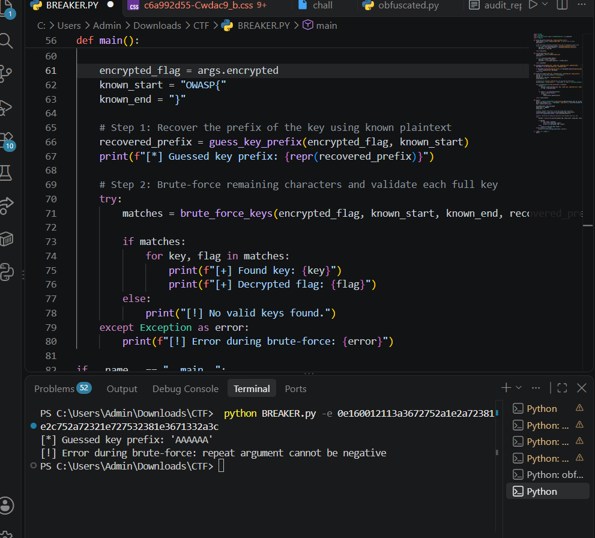
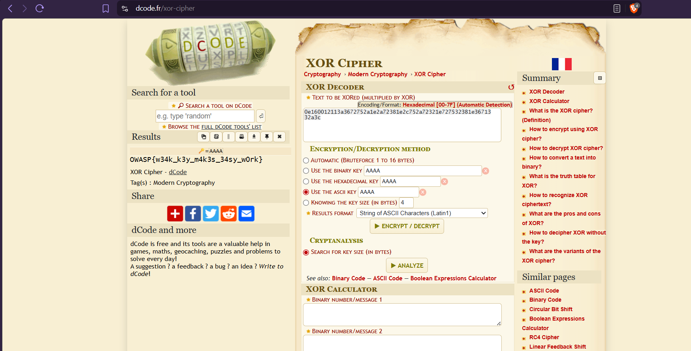
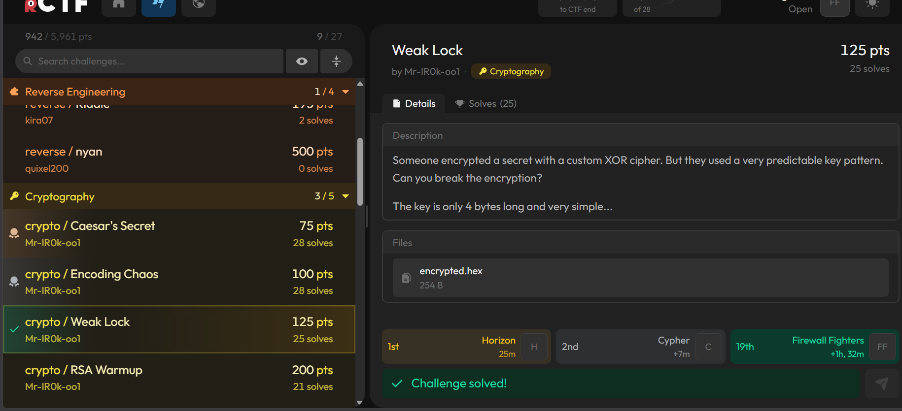


---


## DIGITAL FORENSICS

### Challenge: Hidden in Plain Sight

* **Goal:** Find the hidden flag inside a network traffic capture file that appears to look like raw hex data.
* **Given:** A `.txt` file containing the network capture dump data.

#### How I Solved It:

1. I opened the `.txt` file using a standard code editor (and cross-verified with Notepad).
   The plaintext data was immediately visible in the file contents

* **Flag:** `OWASP{h3x_d4mp5_4r3_y0ur_fr13nd}`

#### Challenge Screenshots
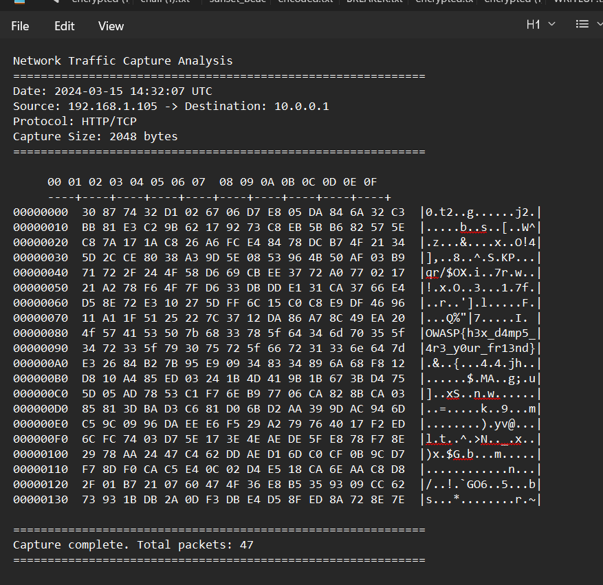
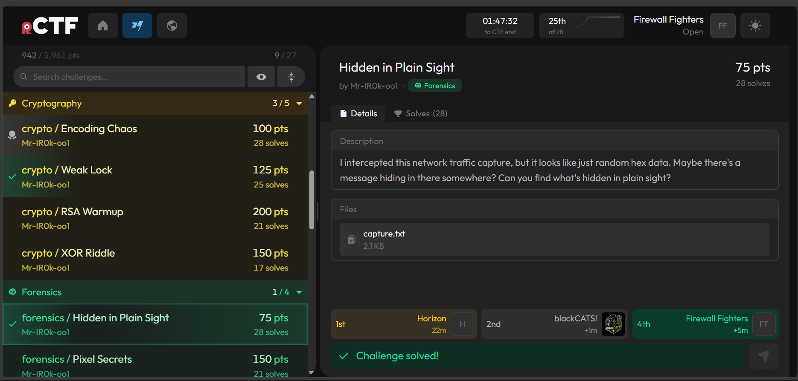


---

## WEB

### Challenge: Hidden Profiles

* **Goal:** Use user IDs to access the administrator profile via an IDOR (Insecure Direct Object Reference) vulnerability.
* **Given:** A web instance hosted globally.

#### How I Solved It:

1. **Instance Initialization:** Started the provided web instance and navigated to the application interface.
2. **Parameter Inspection:** Logged into a standard user account and inspected the URL path structure. The user ID parameter (`uid`) was explicitly visible in the browser address bar, confirming the application utilized the GET method to pull profile data.
3. **ID Manipulation:** Attempted to modify the parameter value to `2` to test for parameter tampering boundaries, which successfully loaded a separate profile page. 
4. **Administrative Escalation:** Altered the `uid` parameter to `0`, acting on the logic that administrative accounts are typically generated first during database initialization where array indexing starts at zero. This successfully bypassed authorization barriers and displayed the administrator profile page along with the flag.

* **Flag:** `OWASP{IDOR_h1dd3n_pr0f1l35}`

#### Challenge Screenshots
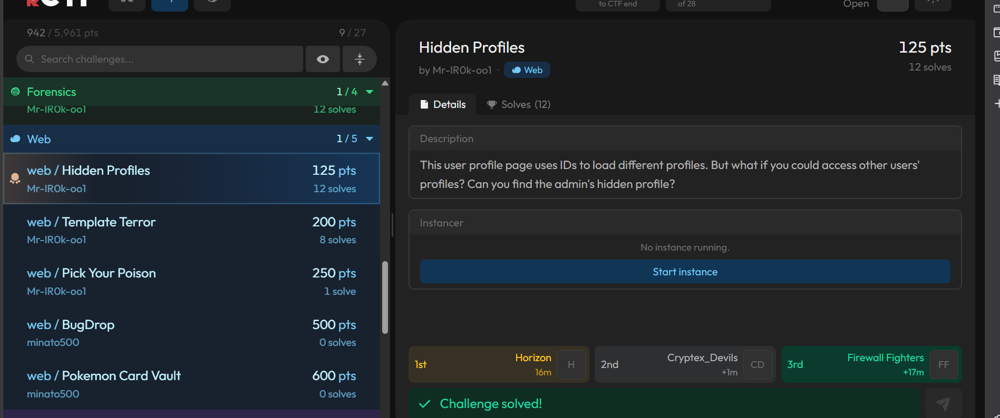

---


## MISCELLANEOUS

### Challenge: Welcome to OWASP SREC

* **Goal:** Read the introductory information to locate the challenge flag.
* **Given:** A text file containing general CTF instructions.

#### How I Solved It:

1. **File Opening:** Opened the provided instructional document.
2. **Information Retrieval:** Reviewed the text body directly. The flag was embedded inside the general instructions in unencrypted plaintext format.

* **Flag:** `OWASP{w3lc0m3_t0_0w4sp_sr3c_ctf_2026}`

---

### Challenge: Cipher Master

* **Goal:** Reverse the multi-layered encoding pipeline to extract the original flag.
* **Given:** A `.txt` file containing an encoded string structured through successive operations: Base64 -> ROT13 -> Base64 -> Reverse.

#### How I Solved It:

1. **String Reversal:** Reversed the entire text payload as the first recovery layer using a Python slice step technique (`[::-1]`).
2. **First Decoding Pass:** Loaded the resulting string into CyberChef and executed the **From Base64** recipe operation.
3. **Cipher Alignment:** Added the **ROT13** decoding recipe rule to process the output from the previous step.
4. **Final Decoding Pass:** Appended an additional **From Base64** block to the recipe stack to break the final containment layer and output the flag.

* **Flag:** `OWASP{mu1t1pl3_3nc0d1ng_l4y3rs}`

#### Challenge Screenshots
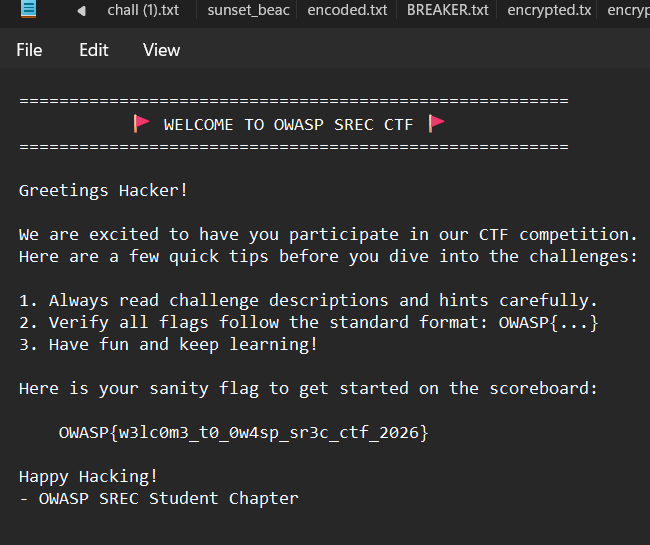

---

### Challenge: 67

* **Goal:** Convert an obfuscated repeating two-character pattern into readable text to obtain the flag.
* **Given:** A `.txt` file containing 385 characters consisting strictly of repeated digits `6` and `7`.

#### How I Solved It:

1. **Pattern Identification:** Observed that the structure relied entirely on a binary state relationship where `7` represents `6 + 1`. If the digit `6` maps to a low bit (`0`), then `7` naturally maps to a high bit (`1`).
2. **Binary Conversion:** Used the Find and Replace feature within a text editor (Notepad) to map the text stream into a standard binary format by substituting all occurrences of `6` with `0` and all occurrences of `7` with `1`.
3. **Data Translation:** Copied the resulting binary string into CyberChef and applied the **From Binary** decoder recipe to translate the bits into plaintext ASCII characters, which rendered the flag.

* **Flag:** `OWASP{c0mpu73r5_d0n7_5p34k_b1n4ry_7h3y_5p34k_67}`

#### Challenge Screenshots
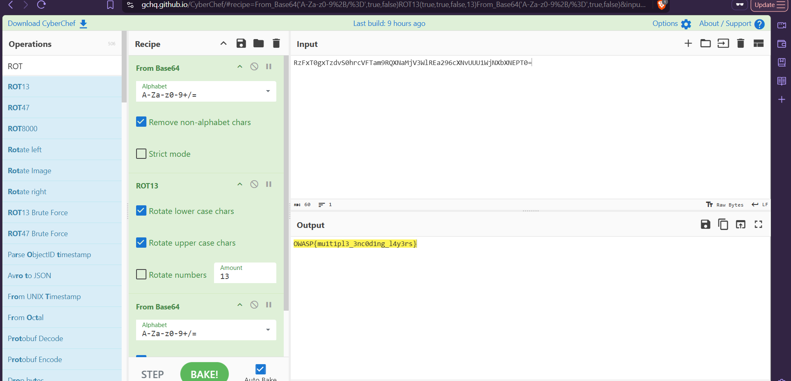
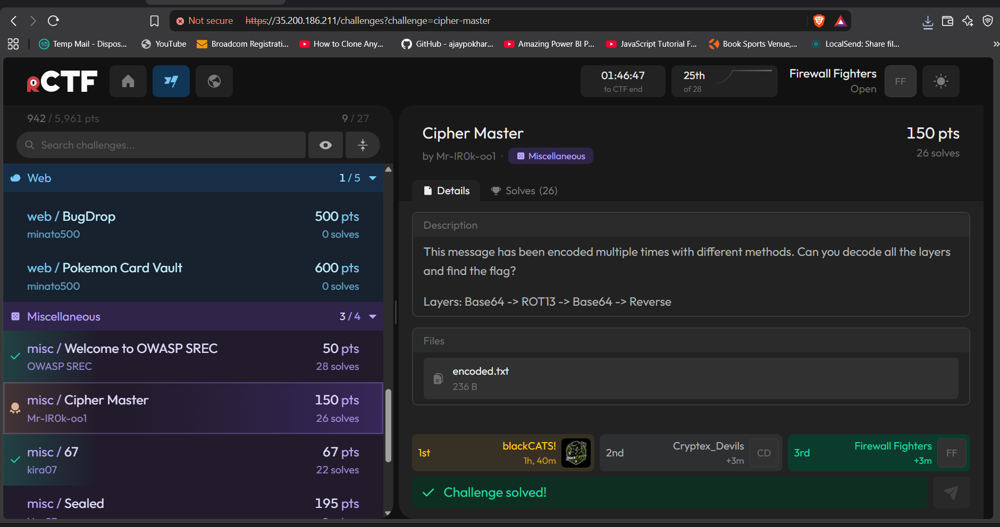


---

## CONCLUSION

### Final Progress Tracking

* **Overall Standing:** Successfully completed **9 out of 27** available challenges during the CTF window.

#### Challenge Screenshots


